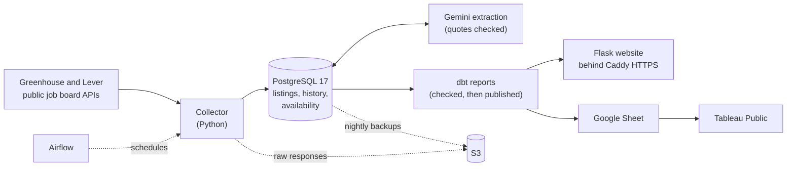

# Job Market Intelligence

Job discovery for data analyst, data engineer, and backend roles, built from permitted
public listings on official company career pages and applicant tracking systems.

**Live:** https://jobobservatory.dev

## Start here

Twice a day the pipeline collects data, analytics, software, and ML jobs from 51 employer
job boards on Greenhouse and Lever, keeps the ones in Dallas-Fort Worth, Greater Houston, or
remote and open to Texas, and records every change to every listing. Gemini reads new
postings and extracts their requirements, dbt builds the reports, and a Flask website serves
job search, the reports, and a private workspace for tracking applications.

Three things worth a look:

- **History you can trust.** Each listing keeps a version for every meaningful change. A
  job is marked unavailable only on trustworthy evidence, a board where many jobs vanish
  at once is put on hold instead of hiding them, and nothing is deleted.
  ([Availability](docs/COLLECTION.md#availability), [Posting history](docs/COLLECTION.md#posting-history))
- **AI answers are checked, not trusted.** Gemini's JSON is validated, every quoted piece of
  evidence must appear in the posting, and the rule-based screen still decides which jobs
  are kept. ([Requirement extraction](docs/EXTRACTION.md#requirement-extraction))
- **Run like a small production system, on one server.** Docker Compose on EC2, Airflow
  for collection, retries, and AI batches, reports rebuilt in shadow schemas and swapped in
  only after their checks pass, nightly backups to S3, and email alerts. PySpark and
  Databricks were measured against PostgreSQL and lost at this size, so the pipeline stays
  on dbt. ([Deployment](docs/OPERATIONS.md#deployment), [PySpark comparison](docs/ANALYTICS.md#pyspark-comparison))

Stack: Python 3.11, PostgreSQL 17, dbt, Flask, Apache Airflow 3, Docker Compose, Caddy,
AWS (EC2, S3, IAM, Session Manager), Cloudflare DNS, Gemini, GitHub Actions.

## Status

Live since 2026-11-04, focused on Dallas-Fort Worth and Greater Houston. What exists today:

- Registries of researched job boards on two applicant tracking systems:
  `config/greenhouse_boards.toml` (57 Greenhouse boards, 21 enabled) and
  `config/lever_boards.toml` (43 Lever boards, 30 enabled, plus one held). Only boards with
  a verified official employer connection and local hiring evidence are enabled; the rest
  stay disabled with the reason recorded. The registries come from a discovery pass and
  do not cover the whole market.
- One collector for both sources: a small connector per provider (HTTP, pagination,
  parsing) feeding shared validation, storage, history, retries, and status. It keeps
  complete, partial, and failed results apart per employer.
- Rule-based screening that keeps relevant data, analytics, BI, software, data science,
  and ML roles located in DFW/Houston or remote and open to Texas residents.
- Retry incidents (three retries over about three hours), an alert/recovery outbox, and
  four-day retention of raw responses.
- Incremental history: a new content version only for meaningful changes, versioned
  normalization rules, current state ordered by collection time, and safe replay of
  saved responses.
- Availability verification: postings move between observed, possibly unavailable,
  assumed inactive, and closed only on trustworthy evidence, with board holds that stop a
  suspicious mass disappearance from hiding jobs. Hidden jobs are never deleted.
- Requirement extraction with Gemini (free tier): a persistent queue sends one request per
  new or changed listing, Python validates the JSON answer and checks every quoted piece
  of evidence against the posting, and results are stored with their model and rule
  versions. Collection never waits for it. Rule-based screening still decides which jobs
  are retained; disagreements with the AI are listed for review.
- Content history for every listing, retained or not, and a display-safe listing form
  (sanitized description, original links, freshness, availability).
- A job-search website (`jobmarket web` on a computer, live on the server): search with
  filters and shareable URLs, duplicate groups shown once, archived jobs kept separate, and
  a detail page with the extracted requirements, their source quotes, and the full
  description, plus a read-only Reports page over the reporting tables. It reads the
  database through a read-only login and never calls a source or the model.
- A private workspace for one owner account: an editable profile, saved jobs, application
  tracking with history, "new since last visit", and explainable comparisons of each job's
  requirements with the profile (Matched, Gap, or Needs review, with quotes; no score).
  Private data lives in its own schema, reachable only through a separate login.
- Duplicate handling: records are grouped only on strong evidence (employer requisition
  ID, identical job-specific application URL); weaker similarity is flagged for review.
  Every source record keeps its own history and availability.
- Unit, database, and end-to-end collection tests, and a GitHub Actions workflow that
  runs them against PostgreSQL 17.
- Hosting on one AWS EC2 t3.small (2 GiB) with Docker Compose: PostgreSQL, gunicorn, Caddy
  with a Let's Encrypt certificate, and Airflow, which runs the collection, retry, and AI
  schedules. Backups and raw responses go to S3, email goes through Gmail, and
  administration uses Session Manager (`deploy/`).

Not yet in place:

- **Dashboards.** The Market insights page shows its headline numbers, but the Tableau
  Public workbook it embeds is not published yet.
- **Measured extraction accuracy.** Extraction is checked for shape and quoted evidence.
  It has been compared with labels on 30 listings, but those labels are drafts that a
  person has not reviewed yet, so the comparison shows agreement, not accuracy.

## Reference documentation

- [Setup, commands, and operations](docs/OPERATIONS.md)
- [Collection, history, and availability](docs/COLLECTION.md)
- [Requirement extraction](docs/EXTRACTION.md)
- [Analytics with dbt, and the dashboard data](docs/ANALYTICS.md)
- [Job search and the website](docs/WEBSITE.md)
- [Deployment runbook](deploy/RUNBOOK.md) and [sizing notes](deploy/SIZING.md)
