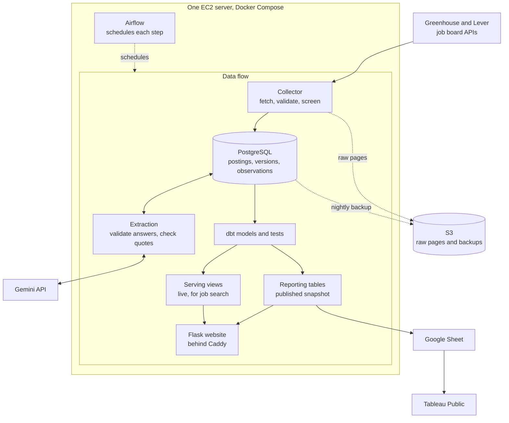

# Job Observatory

[](https://github.com/Niyog59/Job-Market-Intelligence/actions/workflows/ci.yml)

A data engineering project that collects employer job listings, tracks changes over time,
and turns job descriptions into searchable requirements and market analysis.

Built with Python, PostgreSQL, dbt, Airflow, Docker, and AWS, with a Flask application for
job search and Tableau for visualization.

[Live site](https://jobobservatory.dev) · [Pipeline](#how-the-pipeline-works) · [Analysis](#application-and-analysis) · [Decisions](#key-decisions) · [Run locally](#run-it-locally)

| Part | Tools |
|---|---|
| Collection and extraction | Python, Greenhouse and Lever APIs, Gemini |
| Storage and transformations | PostgreSQL, dbt |
| Scheduling and deployment | Airflow, Docker Compose, AWS EC2 |
| Backups and checks | AWS S3, GitHub Actions |
| Application and visualization | Flask; Tableau (data feed running, workbook in progress) |
| Performance experiment, not in production | PySpark, Databricks |

<details>
<summary><strong>Why I built it</strong></summary>

I wanted an easier way to find jobs that fit me. I was checking different company websites
and reading through listings to understand the role, location, and experience requirements.

I built Job Observatory to bring those listings into one place. It collects jobs from
company boards, keeps track of changes, and extracts the requirements so I can search them
more easily.

Once I had the data, I also wanted to understand what employers were asking for and how
requirements differed across roles.

</details>

| The pipeline | The analysis |
|---|---|
| [Architecture and data flow](docs/ARCHITECTURE.md) | [Tableau visualizations](docs/tableau/DASHBOARDS.md) |
| [Collection, history, and duplicate handling](docs/COLLECTION.md) | [Skills and experience requirements](docs/tableau/DASHBOARDS.md#1-what-are-employers-asking-for-main-view-whatemployersaskfor) |
| [dbt transformations and publication](docs/ANALYTICS.md) | [Junior and senior opening patterns](docs/tableau/DASHBOARDS.md#2-junior-vs-senior-hiring-view-juniorvssenior) |
| [Scheduling, tests, and recovery](docs/OPERATIONS.md) | [Metric definitions, coverage, and limitations](docs/ANALYTICS.md#counting-rules) |

## How the pipeline works



At noon and 9 PM (America/Chicago), Airflow collects 51 employer boards. The collector saves
the raw pages and screens each job with rules. PostgreSQL stores a job's identity, its
content versions, and each sighting separately, so a repeated sighting creates no new
version and no AI request.

New versions are queued for extraction: Gemini returns requirements as JSON, and Python
validates each answer and searches the posting for its quotes. Job search reads live dbt
views. The Reports page and the Google Sheet read reporting tables that are rebuilt aside
and swapped in only after their tests pass. The evening run also backs up to S3.
More: [docs/ARCHITECTURE.md](docs/ARCHITECTURE.md).

## Measured results

| Measurement | Result | When and where |
|---|---|---|
| Collection of all 51 boards | 133 s | 2026-11-03, Mac, real data |
| Report publication (build, tests, statistics, swap) | 25 s | 2026-11-03, Mac |
| First scheduled 9 PM run | every step, including the S3 backup, done by 21:04 | 2026-11-04, production |
| Backup restore | production was built from a verified backup; CI restores one on every run | 2026-11-04, production; CI |
| dbt project | 46 SQL models and 125 data tests, all passing in CI | current `main` |

Job counts and extraction coverage change with every collection; they are on the live
[Reports page](https://jobobservatory.dev/reports), with definitions and a dated snapshot in
[docs/METRICS.md](docs/METRICS.md).

**PostgreSQL and dbt against Spark.** I rebuilt three reporting models in PySpark and timed
both on the same prepared inputs (medians of 5 runs, M1 Mac). The 10x and 100x inputs are
synthetic copies of the real data, used as a scale test.

| | 1x (66,367 rows) | 10x | 100x (6.6 million rows) |
|---|---|---|---|
| PostgreSQL, the three models | 0.04 s | 0.35 s | 5.18 s |
| Spark local mode, the three models | 4.62 s | 4.90 s | 12.40 s |
| Spark session startup | 3.78 s | 3.24 s | 3.37 s |
| Export to Parquet (Spark path only) | 0.21 s | 2.36 s | 20.95 s |

These are transformation times, not pipeline runtimes (a full `dbt run` of the three models
took 11.6 s at 1x, mostly upstream models). Spark matched dbt row for row at every size and
on Databricks Free Edition. PostgreSQL was faster at every size I measured on this data, so
the pipeline stays on dbt. Method: [docs/spark/README.md](docs/spark/README.md).

## Application and analysis


*A job page: each extracted requirement links to the sentence it came from, next to the full
description.*

The Tableau workbook is not published yet. Its data reaches the Google Sheet after every
run, and the dashboard designs (skills, role differences, junior and senior mix, AI mentions,
experience) are in [docs/tableau/DASHBOARDS.md](docs/tableau/DASHBOARDS.md).

From the publication of 2026-11-04 (147 open jobs kept by the screening rules, at 29 tracked
employers): of the jobs with a clear level, 10% were junior and 83% senior or above, and 27%
mentioned a generative-AI term. This describes the tracked employers, not the whole market,
and a mention of AI does not explain hiring.

## Key decisions

| Decision | Reason | Tradeoff |
|---|---|---|
| Official Greenhouse and Lever APIs only | complete listings per board, so a missing job means something | only employers on these two systems |
| Separate identities, versions, and observations | small, complete history: when a job changed and when it was last seen | more tables; late data must not overwrite newer state |
| Conservative absence and duplicate rules | a bad scan or a wrong merge cannot hide jobs | closed jobs stay visible longer; some duplicates wait for review |
| PostgreSQL and dbt, after the Spark comparison | faster on this data, one engine to run and back up | single-machine scale |
| Airflow | run history, dependencies, time zones | the largest memory user; why the server needs 2 GiB |
| AI extraction with validation | rules decide which jobs are kept; answers are schema-checked and quotes searched for | answers with evidence problems are kept with warnings; accuracy not measured |

The full reasoning, options, and settings: [docs/DECISIONS.md](docs/DECISIONS.md).

## What broke and how I fixed it

**Slow queries right after a publication**, fixed by running `ANALYZE` before the new tables
are swapped in.

<details>
<summary>Details</summary>

- **What happened:** during the Spark benchmark on my Mac (development), an export started a
  few seconds after a publication ran one query for more than ten minutes.
- **Why:** a publication creates new tables, and new tables have no planner statistics until
  autovacuum analyzes them, so PostgreSQL planned with default estimates. The website's first
  queries after a publication had the same exposure.
- **What changed:** the publish step runs `ANALYZE` on every table of the new build before the
  swap ([`analytics.py`](src/jobmarket/analytics.py), `_analyze`).
- **How I checked it:** the same export finished in 22 seconds once the tables had statistics,
  and [`test_published_tables_have_planner_statistics`](tests/test_publish.py) fails if a
  published table was never analyzed.

</details>

**Evening runs that started after midnight skipped their evening duties**, fixed by
deciding from the scheduled slot instead of the start time.

<details>
<summary>Details</summary>

- **What happened:** in CI, the deploy job's check of recorded steps failed because the
  21:00 run had skipped its backup, prune, and summary steps.
- **Why:** the DAG decided "evening" from the run's start time, and `airflow dags test` sets
  that to the moment the test starts. That CI run started after midnight in Chicago. A real
  run delayed past midnight would have done the same.
- **What changed:** the evening duties follow the run's logical date (its scheduled slot), and
  only manual runs without one use their start time
  ([`jobmarket.py`](deploy/airflow/dags/jobmarket.py), `is_evening`).
- **How I checked it:** tests cover a 21:00 run started after midnight
  ([`test_schedule.py`](deploy/airflow/tests/test_schedule.py),
  [`test_pipeline_runs.py`](deploy/airflow/tests/test_pipeline_runs.py)), and the deploy job
  passes whatever time it runs. A CI failure, not a production incident.

</details>

**No HTTPS certificate on the first deployment**, fixed by setting the real domain in the
server's settings.

<details>
<summary>Details</summary>

- **What happened:** during the first setup on the server, before the site was public, it did
  not load over HTTPS.
- **Why:** the Caddy log showed Let's Encrypt refusing a certificate for
  `change_me.duckdns.org`: the server's settings file still had the placeholder domain from
  the example file.
- **What changed:** I set the real domain and recreated the Caddy container (a plain restart
  keeps the old setting). The example file now asks for the domain, and the
  [runbook](deploy/RUNBOOK.md) checks it and lists the symptom under troubleshooting.
- **How I checked it:** Caddy obtained the certificate, and HTTPS, the HTTP redirect, and the
  closed database port were checked from outside the server.

</details>

## Plans for more employers

- Grow to about 300 to 400 verified employers in stages.
- Before each stage, check collection success, publication time, and the extraction backlog,
  since the free AI tier handles a fixed number of listings a day.
- Count a new board's existing jobs as initial imports, not new openings, and compare trends
  over a consistent group of employers.

## Run it locally

You need Python 3.11 and PostgreSQL 17.

```bash
python3.11 -m venv .venv && source .venv/bin/activate
pip install -e ".[dev,analytics,web]"
cp .env.example .env              # database name, user, and password
jobmarket check-db && jobmarket migrate && jobmarket sources sync
jobmarket collect                 # scans every enabled board
jobmarket analytics build         # builds the dbt models and runs their tests
jobmarket web                     # http://127.0.0.1:8000/
ruff check . && pytest            # tests; database tests skip without a database
```

The analytics login, the Gemini settings, and every other command:
[docs/OPERATIONS.md](docs/OPERATIONS.md).

## Limitations

- Extraction accuracy is not measured. Coverage means a result exists, not that every quote
  was found or that it is right; the 30 evaluation labels are not reviewed yet.
- 51 boards are a sample of employers, not the market.
- One server: a failure means rebuilding from the runbook and the last backup, with up to a
  day of data at risk. Monitoring is email only; backups are not immutable.
- Posting history is permanent, but raw pages stay 4 days on the server (30 in S3), and replay
  reads only the server's copy.

## Documentation

[Start here](docs/START_HERE.md) ·
[Architecture](docs/ARCHITECTURE.md) · [Decisions](docs/DECISIONS.md) ·
[Metrics](docs/METRICS.md) · [Collection](docs/COLLECTION.md) ·
[Extraction](docs/EXTRACTION.md) · [Analytics](docs/ANALYTICS.md) ·
[Website](docs/WEBSITE.md) · [Operations](docs/OPERATIONS.md) ·
[Runbook](deploy/RUNBOOK.md) · [Sizing](deploy/SIZING.md) ·
[Spark comparison](docs/spark/README.md) · [Dashboards](docs/tableau/DASHBOARDS.md)
