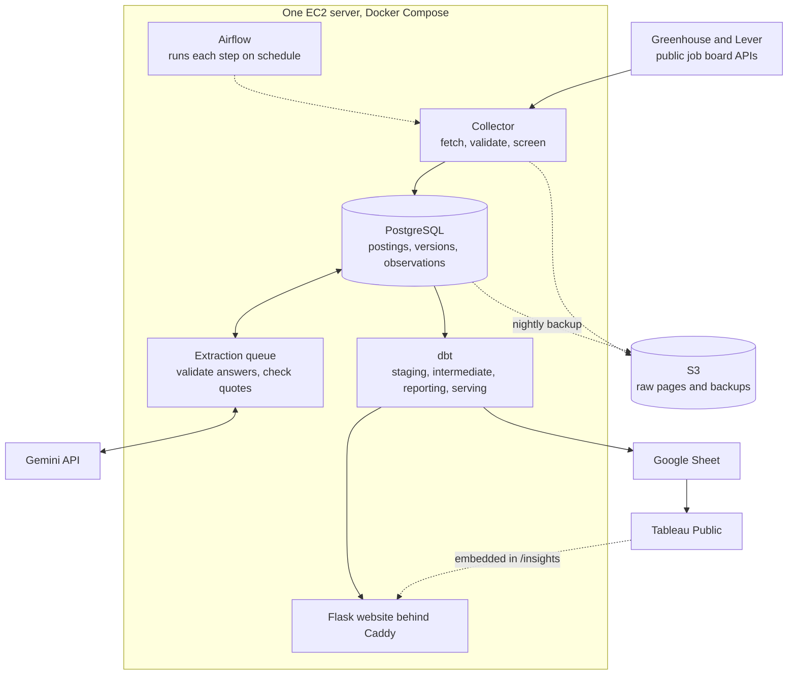

# Job Observatory

A job pipeline and search site for data, analytics, and software roles in Dallas-Fort Worth
and Greater Houston. The repository is named Job Market Intelligence.

**Live site:** https://jobobservatory.dev · **Dashboards:** [not published yet](#live-website-and-tableau-visualizations) ·
**Reviewing the code?** [Start here](docs/START_HERE.md)

## Why I built it

I wanted an easier way to find jobs that fit me. I was checking different company websites
and reading through listings to understand the role, location, and experience requirements.

I built Job Observatory to bring those listings into one place. It collects jobs from
company boards, keeps track of changes, and extracts the requirements so I can search them
more easily.

Once the listings were in one place, I could also look at them as data. The analytical side
of the project asks which skills employers list most often, how much experience they
expect, and how junior openings differ from senior ones. The reports on the site answer
them today, and Tableau dashboards built from the same published tables will add the
visual side.

## Live website and Tableau visualizations

The site at https://jobobservatory.dev has four public parts:

- **Job search** (`/`): search and filter the kept jobs by role, level, location, work
  arrangement, skills, and experience.
- **Job pages** (`/jobs/<id>`): the extracted requirements, each with "View source
  evidence" showing the sentence it came from, next to the full description.
- **Reports** (`/reports`): the published reporting tables, with the time they were built
  and the collection they include.
- **Market insights** (`/insights`): headline numbers now, and the embedded Tableau
  dashboards once the workbook is published.


> **Unfinished: the Tableau workbook.** The dashboards are designed
> ([docs/tableau/DASHBOARDS.md](docs/tableau/DASHBOARDS.md)) and their data is published
> twice a day, but the workbook is not on Tableau Public yet. When it is, its public link and
> a dashboard screenshot go here, and `/insights` embeds it.

The dashboards are meant to answer:

- Which skills appear most often, counted by jobs or by employers?
- How do the requirements of data roles differ from those of software roles?
- What is the mix of junior, mid-level, and senior openings, and how does it change week by
  week within the tracked employers?
- Where do generative-AI terms appear in descriptions, inside and outside AI/ML roles?
- How much experience and which degrees do employers ask for?

How the data reaches Tableau: after each scheduled collection, `jobmarket analytics publish`
rebuilds the dbt reporting tables; when that succeeds, `jobmarket tableau sync` writes the
dashboard tables to a Google Sheet in one request; Tableau Public re-reads the Sheet about
once a day. Every chart carries a "data collected through ..." caption from the
publication it came from, and the Reports page shows the same build time. Details:
[docs/ANALYTICS.md](docs/ANALYTICS.md#dashboard-data-tableau-public).

## What it does

- Collects every listing from 51 employer boards on Greenhouse and Lever, twice a day (noon
  and 9 PM America/Chicago), through their public job board APIs.
- Keeps the jobs that match my role families and are in DFW, Houston, or remote and open to
  Texas, using rules I can read and test.
- Stores every meaningful version of each listing and every time it was seen, so the site
  can say when a job was discovered, when it changed, and when it was last seen.
- Marks a job as possibly unavailable, assumed inactive, or closed only on evidence from
  complete scans or the job's own page, and groups the same opening posted twice.
- Sends new or changed listings to Gemini to extract skills, experience, degree, level, and
  work arrangement, and checks every quoted piece of evidence against the posting.
- Builds reporting tables with dbt and publishes them only after their tests pass.
- Gives me a private workspace behind sign-in for a profile, saved jobs, application
  tracking, and a comparison of each job's requirements with my profile.

## Project snapshot, 2026-11-04

| | Value |
|---|---|
| Employer boards collected | 51 (21 Greenhouse, 30 Lever) |
| Kept jobs listed | 166 postings, 147 distinct openings after duplicate grouping |
| All listings collected and still listed | 5,345 |
| Kept jobs with extracted requirements | 165 of 166 (99.4%) |
| All listings with extracted requirements | 485 of 5,345 (9.1%); the rest wait in a free-tier queue |
| First scheduled evening run on the server | collection, backup confirmed in S3, publication, Sheet update, and summary email finished by 21:04 |
| Tests in CI | 598 in the main job, 17 Spark, 25 Airflow; dbt build with 172 models and tests |
| Hosting | about $20.58 a month at list price before credits (estimate) |
| Extraction accuracy | not measured yet |

Every number, with its definition, source, and environment: [docs/METRICS.md](docs/METRICS.md).

## How the pipeline works



1. **Collect.** A small connector per provider reads each board page by page. The collector
   saves every raw page, decides whether the read was complete, partial, or failed, and
   screens each job with rules.
2. **Store history.** PostgreSQL keeps three things apart: the posting's identity (source,
   board, and the source's job id), its content versions (a new one only for a meaningful
   change), and observations (each time a scan saw it). Repeated sightings show the job is
   still listed and drive the availability rules, without creating versions or AI requests.
   The [architecture notes](docs/ARCHITECTURE.md#identity-versions-and-observations) walk
   through an example.
3. **Extract.** New versions join a queue. Gemini returns the requirements as JSON within the
   free-tier limits; Python validates the answer and searches for every quote in the text that
   was sent.
4. **Model.** dbt builds staging and intermediate models, reporting tables, and serving views.
   A publication builds everything in shadow schemas, runs the data tests, and swaps the
   schemas in one transaction.
5. **Serve.** Job search reads the live serving views. The Reports page, the Market insights
   numbers, and the Google Sheet read the published reporting tables, which carry their build
   time.
6. **Operate.** Airflow runs collection at noon and 9 PM, a retry check every 15 minutes, and
   an extraction batch every hour, one task at a time. The evening run also backs up to S3 and
   emails me a daily summary.

More: [architecture and data model](docs/ARCHITECTURE.md).

## Main engineering decisions

- **Official job board APIs only.** Greenhouse and Lever give complete, structured listings
  per board, which is what lets a missing job mean something. Each board is enabled only
  after I verified it belongs to the employer.
- **Keep history and the raw pages.** Every meaningful version, every sighting, and every raw
  response with its checksum, so I can rebuild what was known on any day and replay a scan
  after changing a rule.
- **Be slow to hide or merge jobs.** Only complete scans count; a job is assumed inactive
  after three missed complete scans; a board where many jobs vanish at once goes on hold;
  duplicates are grouped only on strong evidence.
- **Rules decide, AI enriches.** Screening rules decide which jobs are kept. The model only
  extracts requirements, and every answer is checked for its quotes.
- **PostgreSQL and dbt.** The data already lives in PostgreSQL and the site reads the same
  tables. I rebuilt three reporting models in PySpark and checked them row for row against
  dbt; on prepared inputs PostgreSQL computed them in 0.04 s against 4.6 s for Spark local
  mode (plus 3.8 s of Spark startup), and it stayed faster up to 100 times today's data, so I
  kept dbt ([measurements](docs/spark/README.md)).
- **Airflow, with its cost.** It gives run history, dependencies, and time zone handling, but
  it is the largest memory user and the reason the server needs 2 GiB. cron would have worked
  at this size.
- **One server.** One EC2 t3.small with Docker Compose, Caddy, Session Manager instead of SSH,
  and S3 for backups. Cheap and rebuildable from the runbook, with no high availability.
- **Tableau through a Google Sheet.** Tableau Public cannot reach a private database, so the
  published tables go to a Sheet that only the server's service account can edit.

Each one with the options, costs, and what would make me revisit it:
[docs/DECISIONS.md](docs/DECISIONS.md).

## What broke and how I fixed it

**Slow queries right after a publication.** While benchmarking Spark on my Mac, an export
started a few seconds after a publication ran one query for more than ten minutes. The
cause: a publication creates new tables, and new tables have no planner statistics until
autovacuum analyzes them, so PostgreSQL planned the query with default estimates. The
website's first queries after each publication had the same exposure. The fix: the publish
step now runs `ANALYZE` on every table of the new build before the swap
([`analytics.py`](src/jobmarket/analytics.py), `_analyze`). I checked it by rerunning the
export, which then finished in 22 seconds, and by a regression test that fails if any
published table has never been analyzed
([`test_published_tables_have_planner_statistics`](tests/test_publish.py)). This happened
in development, not on the server.

**Evening runs that started after midnight.** The 9 PM run has extra duties: the backup, the
summary email, and cleanup. The DAG decided whether a run was an evening run from its actual
start time. `airflow dags test`, which the CI deploy job uses, sets that to the moment the
test starts, so when CI happened to run after midnight in Chicago the 21:00 run was treated
as a daytime run, skipped its evening steps, and failed the check of recorded steps. A real
run delayed past midnight would have done the same. The fix: the evening duties now follow
the run's scheduled slot (its logical date) and fall back to the start time only for manual
runs ([`jobmarket.py`](deploy/airflow/dags/jobmarket.py), `is_evening`). Tests cover a
21:00 run started after midnight
([`test_schedule.py`](deploy/airflow/tests/test_schedule.py),
[`test_pipeline_runs.py`](deploy/airflow/tests/test_pipeline_runs.py)), and the CI deploy job
passes whatever time it runs. This was a CI failure, not a production incident.

**No HTTPS certificate on the first deployment.** When I first started the site on the
server, it did not load over HTTPS. DNS and the open ports checked out, and the Caddy log
showed Let's Encrypt refusing a certificate for `change_me.duckdns.org`: the server's
settings file still had the placeholder domain from the example file. Setting the real
domain and recreating the Caddy container fixed it (a plain restart keeps the old setting).
I then changed the example file to ask for the domain, and added a check and a
troubleshooting entry to the [runbook](deploy/RUNBOOK.md). This was during setup, before the
site was public.

## Plans for more employers

The next step is growing coverage toward roughly 300 to 400 employers, in measured stages
rather than all at once.

- **Verify each new board** the same way as the current ones: the employer's own careers page
  has to reference it, and the employer has to hire in DFW or Houston.
- **Add a source only when it is justified,** for example when enough target employers use a
  system the pipeline does not read yet.
- **Measure each stage:** collection success per board and the duration of each run,
  publication time, and memory on the server, before adding the next group.
- **Watch extraction capacity.** The free tier allows a fixed number of requests a day, so I
  track the queue size and the age of the oldest pending listing, and keep new or changed kept
  jobs first in the queue.
- **Separate new boards from new openings.** A newly added board's existing jobs are already
  counted as initial imports, not as new openings. Trend comparisons will also need a
  consistent group of employers, so that adding boards does not look like hiring growth.

## Run it locally

You need Python 3.11 and PostgreSQL 17.

```bash
python3.11 -m venv .venv && source .venv/bin/activate
pip install -e ".[dev,analytics,web]"
cp .env.example .env              # database name, user, and password
jobmarket check-db                # connects and runs SELECT 1
jobmarket migrate                 # creates the schema
jobmarket sources sync            # loads the board registry
jobmarket collect                 # scans every enabled board
jobmarket analytics build         # builds the dbt models and runs their tests
jobmarket web                     # http://127.0.0.1:8000/
```

The analytics and website steps need a separate analytics login, and extraction needs a
Gemini API key and the account's limits; see [docs/OPERATIONS.md](docs/OPERATIONS.md).

Tests:

```bash
ruff check . && ruff format --check .
pytest
```

Database tests skip without a reachable database (set `JOBMARKET_REQUIRE_DB=1` to make that a
failure, as CI does). The Spark tests need the `spark` extra and Java 17 or 21, and the
Airflow DAG tests need Airflow; CI runs both in their own jobs.

## Limitations

- **Extraction accuracy is not measured.** Coverage only says a listing has structured details
  whose quotes were found in the text. The 30 evaluation cases have draft labels that a
  person has not reviewed yet.
- **51 boards are a sample.** The numbers describe these employers, not the whole market.
- **The Tableau workbook is not published yet.**
- **One server, no high availability.** If it fails, the site is down until it is rebuilt from
  the runbook and an S3 backup, and up to a day of collected data can be lost.
- **Memory on the server has not been recorded yet.** The 2 GiB size rests on measurements
  taken before deployment ([SIZING.md](deploy/SIZING.md)).
- **Monitoring is email only.** Heartbeat and uptime checks are prepared but not switched on.
- **Backups are not immutable.** The server cannot delete them, but they can be overwritten or
  removed by an administrator; S3 versioning or Object Lock is not set up.

## Documentation

| | |
|---|---|
| [Start here](docs/START_HERE.md) | three areas of the code worth reading, with their tests |
| [Architecture and data model](docs/ARCHITECTURE.md) | the pipeline, identity and versions, live views and snapshots |
| [Decisions](docs/DECISIONS.md) | the main choices, their costs, and the settings |
| [Metrics](docs/METRICS.md) | every number above, with its source |
| [Collection and history](docs/COLLECTION.md) | connectors, evidence, availability, duplicates, the schema |
| [Requirement extraction](docs/EXTRACTION.md) | the queue, checks, limits, and evaluation |
| [Analytics](docs/ANALYTICS.md) | dbt layers, counting rules, serving views, the Sheet behind Tableau |
| [Website](docs/WEBSITE.md) | search rules, pages, the private workspace |
| [Operations](docs/OPERATIONS.md) | configuration, every command, scheduling, backups, tests, CI |
| [Runbook](deploy/RUNBOOK.md) and [sizing](deploy/SIZING.md) | deploying to EC2 and the memory evidence |
| [Spark comparison](docs/spark/README.md) | the PySpark and Databricks measurements |
| [Dashboards](docs/tableau/DASHBOARDS.md) | the dashboard designs, data dictionary, and build guide |
