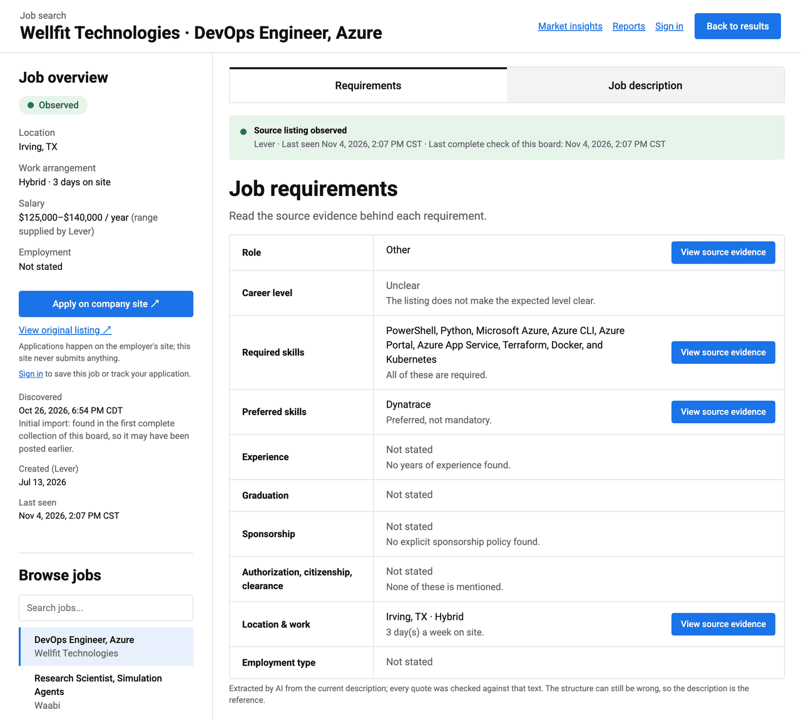
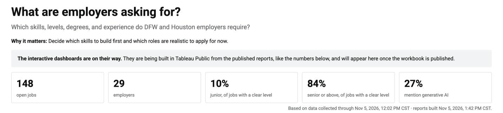
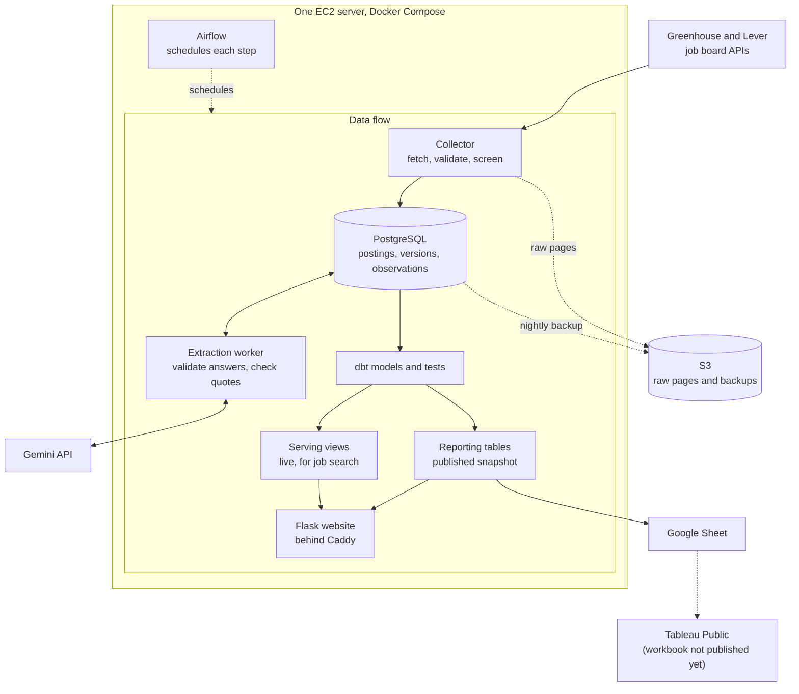

# Job Observatory

[](https://github.com/Niyog59/Job-Market-Intelligence/actions/workflows/ci.yml)

I wanted an easier way to find data and backend jobs I could actually apply to, without
checking each company's career page. So I built Job Observatory: it collects listings from
employers' job boards three times a day, keeps every version of every listing, and asks an AI model
to pull out the requirements, such as skills, years of experience, and sponsorship. Then I can
search all of it in one place.

Once the data was piling up, I got curious about the listings themselves. How many jobs are
open to someone early in their career? Which skills come up again and again? Those questions are
now half the project.

<!-- LIVE_STATS:START -->
63 employer boards checked three times a day · 188 open jobs tracked right now · 204 jobs kept in total · requirements extracted on 207 of 207 kept postings (100%) · updated 2026-11-10
<!-- LIVE_STATS:END -->

[Start here](docs/START_HERE.md) · [Live site](https://jobobservatory.dev) · [Reports](https://jobobservatory.dev/reports) ·
[Market insights](https://jobobservatory.dev/insights) · [Results](#measured-results) ·
[What the data shows](#what-the-data-shows) · [Problems](#problems-i-ran-into) ·
[Run it locally](#run-it-locally)

## Demo



*A job page on [jobobservatory.dev](https://jobobservatory.dev). Each extracted requirement
links back to the sentence it came from, so I can check the AI's answer against the listing.*

The live site has four parts:

- **[Newest jobs](https://jobobservatory.dev/newest):** every job found in the past 3 days,
  newest first, listed as soon as it is collected, before the AI reads it.
- **Job search** with filters for role, location, level, experience, skills, and sponsorship.
- **[Reports](https://jobobservatory.dev/reports):** inventory, daily activity, skills,
  experience, seniority, and sponsorship tables, rebuilt after each collection.
- **[Market insights](https://jobobservatory.dev/insights):** the headline numbers. The
  Tableau dashboards are not published yet; see [Dashboards](#dashboards).

## Measured results

Each number says where it was measured. "Mac copy" is my local database, the same data the
server was restored from.

| What | Result | Where and when |
|---|---|---|
| Collect all 51 employer boards | 133 s, all 51 complete | Mac copy, real boards, 2026-11-03 |
| Publish the reports (build, tests, statistics, swap) | 25 s | Mac copy, 2026-11-03 |
| An export that stalled after a publication | over 10 minutes, then 22 s once the new tables had statistics | Mac copy, 2026-11-03 ([problem](#problems-i-ran-into)) |
| Three reporting models, PostgreSQL vs Spark | 5.18 s vs 12.40 s at 6.6 million synthetic rows | M1 Mac, transformation time only ([comparison](#postgresql-and-dbt-or-spark)) |
| Three reporting models, Spark on Databricks | 10.9 s, same rows as PostgreSQL | Databricks Free Edition, at today's size (66,367 rows), 2026-11-03 |
| First scheduled 9 PM run | every step, including the S3 backup and the Sheet update, done by 21:04 | production, 2026-11-04 |
| Kept jobs with extracted details | 166 of 167 listed postings (99.4%) | production, reports built 2026-11-05 |
| dbt project | 46 SQL models and 125 data tests, all passing | CI, every run |

Coverage means a listing has an extraction result. It is not accuracy: I have not measured
how often the extracted details are right. The live numbers change with every collection, so
the [Reports page](https://jobobservatory.dev/reports) has the current ones, and
[METRICS.md](docs/METRICS.md) has definitions and a dated snapshot.

## What the data shows



From the reports built on 2026-11-05 at 1:42 PM (Chicago time), with collections up to noon
that day. The population is the 148 open jobs kept by the screening rules (data, analytics,
software, and machine learning roles in Dallas-Fort Worth, Houston, or remote and open to
Texas) at 29 of the 51 employers I track. A job posted more than once counts once.

- **Few junior roles.** Of the jobs with a clear level, 10% are junior and 84% are senior or
  above.
- **Experience asks are high.** Looking at the smallest number of years each listing
  requires, 63 of the 166 kept postings with extracted details (38%) ask for 5 to 7 years and
  13 (8%) for 8 or more. Only 21 (13%) ask for 2 years or less, and 44 (27%) do not say.
- **Python leads.** Python is a required skill in 54 of those 166 postings (33%) and SQL in
  26 (16%). The kept group mixes data roles with backend and software roles, so these shares
  are for all of them together.
- **Generative AI shows up a lot.** 27% of the 148 open jobs mention a generative-AI term.

This is one snapshot of a small, chosen group of employers, collected since 2026-10-25. It is
not the whole job market, and it is too early for trends. A listing that mentions AI tells me
what the listing says; it does not explain why anyone is hiring.

### Dashboards

The Tableau part is half done. After every successful publication, the pipeline replaces
nine dashboard tables in a Google Sheet with one all-or-nothing request
([`sheets.py`](src/jobmarket/sheets.py)), and that has run on the server since 2026-11-04. The
Tableau workbook that reads the Sheet is not published yet, so there is no dashboard to link.
The planned dashboards are in [DASHBOARDS.md](docs/tableau/DASHBOARDS.md).

## How it works



At 8 AM, noon, and 9 PM (Chicago time), Python reads every employer's Greenhouse or Lever board
through its public API and saves the raw pages. A listing's identity, each version of its
text, and each time it was seen are stored separately, so I always know when a job changed
and when it was last there. Seeing the same text again adds a sighting, not a new version, and
costs no AI request.

New versions of kept jobs go to Gemini, which fills a fixed JSON form. Python checks the
answer against the schema and searches the listing for every quote the model gives as
evidence. dbt then turns the history into tested tables. Job search reads live views, so a
new result shows up right away. The reports only change when a whole new build passes its
tests.

| Part | Where to look |
|---|---|
| Commands | [`cli.py`](src/jobmarket/cli.py) |
| Collection and history ([docs](docs/COLLECTION.md)) | [`collector.py`](src/jobmarket/collector.py), [`classify.py`](src/jobmarket/classify.py), [`store.py`](src/jobmarket/store.py), [`availability.py`](src/jobmarket/availability.py), [`duplicates.py`](src/jobmarket/duplicates.py), [`test_history.py`](tests/test_history.py), [`test_classify.py`](tests/test_classify.py) |
| AI extraction ([docs](docs/EXTRACTION.md)) | [`extraction.py`](src/jobmarket/extraction.py), [`extraction_worker.py`](src/jobmarket/extraction_worker.py), [`extraction_check.py`](src/jobmarket/extraction_check.py), [`test_extraction_check.py`](tests/test_extraction_check.py) |
| Transformations and publication ([docs](docs/ANALYTICS.md)) | [`analytics/models/`](analytics/models/), [`analytics.py`](src/jobmarket/analytics.py), [`test_publish.py`](tests/test_publish.py) |
| Scheduling, backups, recovery ([docs](docs/OPERATIONS.md), [runbook](deploy/RUNBOOK.md)) | [DAGs](deploy/airflow/dags/jobmarket.py), [`incidents.py`](src/jobmarket/incidents.py), [`backup.py`](src/jobmarket/backup.py), [`deploy/airflow/tests/`](deploy/airflow/tests/) |
| Website and dashboard feed ([docs](docs/WEBSITE.md)) | [`search.py`](src/jobmarket/search.py), [`web/`](src/jobmarket/web/), [`sheets.py`](src/jobmarket/sheets.py), [`reporting/`](analytics/models/reporting/) |

Tools: Python, PostgreSQL 17, dbt, Airflow, Docker Compose on one AWS EC2 server, S3 for raw pages and backups, Flask, Gemini, and GitHub Actions. That is what runs in production.

PySpark and Databricks Free Edition are not part of it. I used them only for the comparison below, where I checked whether Spark would do the reporting step better than PostgreSQL. It did not, so I kept PostgreSQL. More detail: [ARCHITECTURE.md](docs/ARCHITECTURE.md).

## Problems I ran into

The full write-ups, with what I checked, are in [PROBLEMS.md](docs/PROBLEMS.md).

- **New jobs were hard to find** (production, found 2026-11-06). The data was live, but the
  default search showed 13 of 5,297 active jobs: kept jobs only, early career only. I added
  a Newest jobs page that lists every job found in the past 3 days before the AI reads it.

- **Google errors used up a day of AI requests** (production, 2026-11-04 and 11-05, not fixed
  yet). Google's model kept answering "high demand" (HTTP 503), and every retry counted toward
  the free daily limit. By 9 PM on 2026-11-04, 34 of 124 requests had failed. They touched 14
  listings, and all 14 got an answer later. The next day, 352 of 450 requests failed. Next step: pause
  after a listing fails a whole round, instead of moving straight to the next one.
- **AI extraction was falling behind** (production). The hourly batch took at most 20
  listings, and on 2026-11-05 the oldest waiting new listing had been queued for 38.8 hours.
  I moved extraction into a dedicated worker that checks for work every 15 seconds and keeps
  new listings ahead of the backlog. It runs on the server since 2026-11-05, but I have no
  speed numbers from production yet. It also cannot beat the daily limit of 500 requests,
  so the backlog of about 4,800 older listings is still there.
- **An export stalled for over ten minutes** (development). Right after a publication, the
  new tables had no planner statistics, so PostgreSQL picked a bad plan. Publishing now runs
  `ANALYZE` before the swap, and the same export took 22 seconds.
- **Evening runs that started after midnight skipped the backup and summary** (a CI failure,
  not a production incident). The schedule decided "evening" from the start time. It now uses
  the run's scheduled slot.
- **No HTTPS on the first deployment** (production setup, before the site was public). The
  server still had the example file's placeholder domain. The runbook now checks it.

## Decisions

### PostgreSQL and dbt, or Spark?

I wanted to see whether Spark would help, so I rebuilt three of the reporting models in
PySpark and timed both versions on the same inputs (medians of 5 runs on an M1 Mac). With
about 6.6 million rows of synthetic test data, made by copying the real data 100 times,
PostgreSQL finished the three transformations in 5.18 seconds. Spark in local mode took
12.40 seconds, plus about 3.4 seconds to start. Both gave the same rows at every size, and
Spark on Databricks Free Edition matched them on the real-size data. I kept PostgreSQL.

| | 1x (66,367 rows, real) | 10x (synthetic) | 100x (6.6 million rows, synthetic) |
|---|---|---|---|
| PostgreSQL, the three models | 0.04 s | 0.35 s | 5.18 s |
| Spark local mode, the three models | 4.62 s | 4.90 s | 12.40 s |
| Spark session startup | 3.78 s | 3.24 s | 3.37 s |

These are transformation times, not whole-pipeline times. A full `dbt run` of the three
models took 11.6 s at 1x, mostly because of the upstream models. Method and every number:
[docs/spark/README.md](docs/spark/README.md).

### Other choices

| Decision | Why | What it costs |
|---|---|---|
| Only the official Greenhouse and Lever APIs | complete listings per board, so a missing job means something | only employers on those two systems |
| Separate identities, versions, and sightings | a small, complete history of every job | more tables, and late data must not overwrite newer state |
| Careful rules for "closed" and "duplicate" | one bad scan or a wrong merge cannot hide a job | closed jobs stay visible longer; some duplicates wait for review |
| Rules decide which jobs are kept; AI only adds details | screening stays predictable and cheap | the AI's accuracy is still not measured |
| Airflow on one server | run history, dependencies, and time zones | Airflow is the biggest memory user, which is why the server needs 2 GiB |
| One extraction worker on the free tier | at the configured pace of one request every 4 seconds, a second worker would only wait its turn | the daily limit, not the code, sets how many listings get details |

The reasoning and the options I turned down: [DECISIONS.md](docs/DECISIONS.md).

## Run it locally

You need Python 3.11 and PostgreSQL 17.

```bash
python3.11 -m venv .venv && source .venv/bin/activate
pip install -e ".[dev,analytics,web]"
cp .env.example .env              # database name, user, and password
jobmarket check-db && jobmarket migrate && jobmarket sources sync
jobmarket collect                 # scans every enabled board
jobmarket analytics build         # builds the dbt models and runs their tests
jobmarket web                     # http://127.0.0.1:8000/
ruff check . && pytest            # tests; database tests skip without a database
```

The analytics login, the Gemini settings, and every other command:
[docs/OPERATIONS.md](docs/OPERATIONS.md).

## Limitations

- Extraction accuracy is not measured. Coverage means a result exists, not that every quote
  was found or that it is right; the 30 evaluation labels are not reviewed yet.
- <!--PROFILE:boards-->63<!--/PROFILE:boards--> boards are a sample of employers, not the market. I add verified boards in
  batches of at most 25 and measure each batch before the next
  ([how](docs/COLLECTION.md#adding-boards)).
- The free AI tier allows 500 requests a day, so most of the roughly 5,300 collected listings
  outside the kept group still have no extracted details.
- One server: a failure means rebuilding from the runbook and the last backup, with up to a
  day of data at risk. Monitoring is email only; backups are not immutable.
- Posting history is permanent, but raw pages stay 4 days on the server (30 in S3), and replay
  reads only the server's copy.

## Documentation

[Start here](docs/START_HERE.md) ·
[Architecture](docs/ARCHITECTURE.md) · [Decisions](docs/DECISIONS.md) ·
[Problems and fixes](docs/PROBLEMS.md) · [Metrics](docs/METRICS.md) ·
[Collection](docs/COLLECTION.md) · [Extraction](docs/EXTRACTION.md) ·
[Analytics](docs/ANALYTICS.md) · [Website](docs/WEBSITE.md) ·
[Operations](docs/OPERATIONS.md) · [Runbook](deploy/RUNBOOK.md) · [Sizing](deploy/SIZING.md) ·
[Spark comparison](docs/spark/README.md) · [Dashboards](docs/tableau/DASHBOARDS.md)
