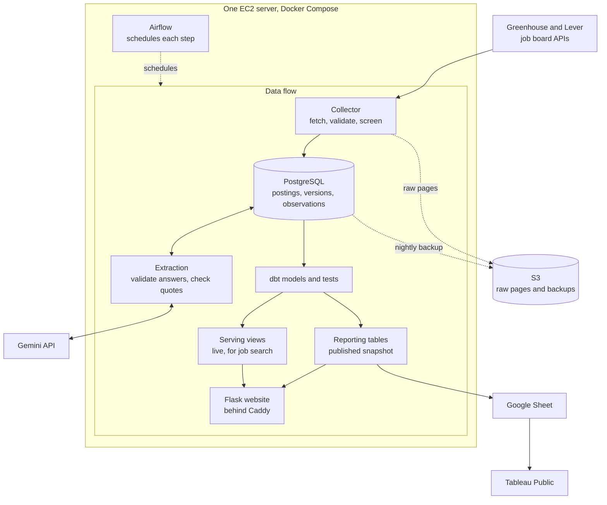

# Job Observatory

[](https://github.com/Niyog59/Job-Market-Intelligence/actions/workflows/ci.yml)

I wanted an easier way to find jobs that fit me without checking each company's career page
separately. So I built Job Observatory, a data engineering project that collects employer
listings, tracks changes, and extracts job requirements for search and analysis. Once I had
the data, I also wanted to see what employers ask for and how that differs across roles.

Python collects listings from the employers' Greenhouse and Lever job boards and asks Gemini to
read the requirements. PostgreSQL keeps every version of every listing, dbt turns that history
into tested tables, and Airflow runs each step twice a day in Docker on one AWS server. A Flask
site serves job search and reports, and the reporting tables feed a Google Sheet for Tableau.

[Live site](https://jobobservatory.dev) · [How it is built](#how-it-is-built) · [Results](#measured-results) · [Decisions](#key-decisions) · [Run locally](#run-it-locally)

| Part | Tools |
|---|---|
| Collection and extraction | Python, Greenhouse and Lever APIs, Gemini |
| Storage and transformations | PostgreSQL, dbt |
| Scheduling and deployment | Airflow, Docker Compose, AWS EC2 |
| Backups and checks | AWS S3, GitHub Actions |
| Application and visualization | Flask; Tableau (data feed running, workbook in progress) |
| Comparison experiment, not in production | PySpark, Databricks |

## How it is built

| Part | How it works | Implementation |
|---|---|---|
| Collection and history | Each board is read through its public API and every raw page is saved. A job's identity, its content versions, and each sighting are stored separately. One missing scan never hides a job, and duplicates merge only on strong evidence. [Collection](docs/COLLECTION.md), [posting history](docs/COLLECTION.md#posting-history) | [`collector.py`](src/jobmarket/collector.py), [`store.py`](src/jobmarket/store.py), [`availability.py`](src/jobmarket/availability.py), [`duplicates.py`](src/jobmarket/duplicates.py), [`test_history.py`](tests/test_history.py) |
| Requirement extraction | Rules decide which jobs are kept. Gemini fills a fixed JSON schema for each new version, and Python validates the answer and searches the posting for every quote. [Extraction](docs/EXTRACTION.md) | [`extraction.py`](src/jobmarket/extraction.py), [`extraction_check.py`](src/jobmarket/extraction_check.py), [`test_extraction_check.py`](tests/test_extraction_check.py) |
| Transformations and publication | dbt builds staging, intermediate, reporting, and serving models. Reporting tables are rebuilt in shadow schemas, tested, analyzed, and swapped in together. [Analytics](docs/ANALYTICS.md) | [`analytics/models/`](analytics/models/), [`analytics.py`](src/jobmarket/analytics.py), [`test_publish.py`](tests/test_publish.py) |
| Scheduling and recovery | Airflow runs collection, retries, publication, and nightly S3 backups; a separate worker extracts new listings, with an hourly batch as the fallback. CI restores a backup on every run. [Operations](docs/OPERATIONS.md), [runbook](deploy/RUNBOOK.md) | [`jobmarket.py` DAGs](deploy/airflow/dags/jobmarket.py), [`extraction_worker.py`](src/jobmarket/extraction_worker.py), [`incidents.py`](src/jobmarket/incidents.py), [`backup.py`](src/jobmarket/backup.py), [`deploy/airflow/tests/`](deploy/airflow/tests/) |
| Search and analysis | Job search reads live serving views. The Reports page and the Google Sheet for Tableau read the published reporting tables. [Website](docs/WEBSITE.md), [dashboard data](docs/ANALYTICS.md#dashboard-data-tableau-public), [dashboard designs](docs/tableau/DASHBOARDS.md) | [`search.py`](src/jobmarket/search.py), [`web/`](src/jobmarket/web/), [`sheets.py`](src/jobmarket/sheets.py), [`reporting/`](analytics/models/reporting/), [`test_sheets.py`](tests/test_sheets.py) |

## How the pipeline works



Collection runs at noon and 9 PM (America/Chicago). A repeated sighting of unchanged text adds
an observation but no new version and no AI request. Job search sees new data at once, while
reports change only when a publication passes its tests.
More: [docs/ARCHITECTURE.md](docs/ARCHITECTURE.md).

## Measured results

| Measurement | Result | When and where | Evidence |
|---|---|---|---|
| Collection of all 51 boards | 133 s | 2026-11-03, Mac with real data | [query 2](docs/METRICS.md#queries) |
| Report publication (build, tests, statistics, swap) | 25 s | 2026-11-03, Mac | [query 3](docs/METRICS.md#queries) |
| First scheduled 9 PM run | every step, including the S3 backup and the Sheet update, done by 21:04 | 2026-11-04, production | [snapshot](docs/METRICS.md#historical-snapshot-2026-11-04) |
| Backup restore | production was built from a verified backup; CI restores one on every run | 2026-11-04, production; every CI run | [CI workflow](.github/workflows/ci.yml) |
| dbt project | 46 SQL models and 125 data tests, all passing | current `main`, CI | [`analytics/`](analytics/) |

Job counts and extraction coverage change with every collection, so they live on the
[Reports page](https://jobobservatory.dev/reports). Coverage means a listing has an extraction
result. It is not accuracy, which I have not measured yet. Definitions and a dated snapshot:
[docs/METRICS.md](docs/METRICS.md).

**PostgreSQL and dbt against Spark.** I rebuilt three reporting models in PySpark and timed
both on the same prepared inputs (medians of 5 runs, M1 Mac). The 10x and 100x inputs are
synthetic copies of the real data, used as a scale test.

| | 1x (66,367 rows) | 10x | 100x (6.6 million rows) |
|---|---|---|---|
| PostgreSQL, the three models | 0.04 s | 0.35 s | 5.18 s |
| Spark local mode, the three models | 4.62 s | 4.90 s | 12.40 s |
| Spark session startup | 3.78 s | 3.24 s | 3.37 s |
| Export to Parquet (Spark path only) | 0.21 s | 2.36 s | 20.95 s |

These are transformation times, not pipeline runtimes (a full `dbt run` of the three models
took 11.6 s at 1x, mostly upstream models). Spark matched dbt row for row at every size and
on Databricks Free Edition. PostgreSQL was faster at every size I measured on this data, so
the pipeline stays on dbt. Method: [docs/spark/README.md](docs/spark/README.md).

## Job search and analysis


*A job page: each extracted requirement links to the sentence it came from, next to the full
description.*

Tableau's part so far is the data feed. After every successful publication, the pipeline
replaces nine dashboard tables and a caption row in a Google Sheet with one all-or-nothing
request ([`sheets.py`](src/jobmarket/sheets.py)). This has run on the server since 2026-11-04.
The workbook that reads the Sheet is not published yet, so there is no dashboard to show. The
designs are in [DASHBOARDS.md](docs/tableau/DASHBOARDS.md) and the fields in
[DATA_DICTIONARY.md](docs/tableau/DATA_DICTIONARY.md).

From the publication of 2026-11-04 (147 open jobs kept by the screening rules, at 29 tracked
employers): of the jobs with a clear level, 10% were junior and 83% senior or above, and 27%
mentioned a generative-AI term. This describes the tracked employers, not the whole market,
and a mention of AI does not explain hiring.

## Key decisions

| Decision | Reason | Tradeoff | Where |
|---|---|---|---|
| Official Greenhouse and Lever APIs only | complete listings per board, so a missing job means something | only employers on these two systems | [`greenhouse.py`](src/jobmarket/greenhouse.py), [`lever.py`](src/jobmarket/lever.py) |
| Separate identities, versions, and observations | small, complete history: when a job changed and when it was last seen | more tables; late data must not overwrite newer state | [`store.py`](src/jobmarket/store.py), [`test_history.py`](tests/test_history.py) |
| Conservative absence and duplicate rules | a bad scan or a wrong merge cannot hide jobs | closed jobs stay visible longer; some duplicates wait for review | [`availability.py`](src/jobmarket/availability.py), [`duplicates.py`](src/jobmarket/duplicates.py) |
| PostgreSQL and dbt, after the Spark comparison | faster on this data, one engine to run and back up | single-machine scale | [`analytics/`](analytics/), [comparison](docs/spark/README.md) |
| Airflow | run history, dependencies, time zones | the largest memory user; why the server needs 2 GiB | [DAGs](deploy/airflow/dags/jobmarket.py), [sizing](deploy/SIZING.md) |
| AI extraction with validation | rules decide which jobs are kept; answers are schema-checked and quotes searched for | answers with evidence problems are kept with warnings; accuracy not measured | [`extraction_check.py`](src/jobmarket/extraction_check.py) |

The full reasoning, options, and settings: [docs/DECISIONS.md](docs/DECISIONS.md).

## What broke and how I fixed it

**AI extraction was falling behind**, addressed by moving it into a dedicated worker. The
worker runs on the server since 2026-11-05; its speed there is not measured yet.

<details>
<summary>Details</summary>

- **What happened:** new listings waited hours for AI extraction. On 2026-11-05 the oldest
  waiting new listing had been in the queue for 38.8 hours.
- **Why:** extraction ran as an hourly batch of at most 20 listings, and that batch shared
  Airflow's single task slot with collection, reports, and backups. When a collection found
  more than 20 new listings, the rest waited for later hours. Each batch took a minute or
  two, so the free per-minute allowance sat unused for the rest of the hour.
- **What changed:** extraction moved into a dedicated worker
  ([`extraction_worker.py`](src/jobmarket/extraction_worker.py)) that checks for waiting jobs
  continuously, every 15 seconds when idle. It handles new listings first and works through
  the older backlog with spare capacity, at most 250 requests a day, so 200 always stay free
  for new listings. The queue changes it relies on are in
  [`extraction.py`](src/jobmarket/extraction.py): each job is claimed by one process at a
  time, and every process shares one rate limit. It is one worker, not several in parallel.
  The hourly batch stays as a fallback and skips itself while the worker runs.
- **What did not change:** the daily API limit. The free tier allows 500 requests a day and
  extraction stops at 450. The worker shortens each new listing's wait; it does not raise how
  many listings a day can be extracted. The backlog of about 4,800 older listings is not
  cleared and still clears only at the free tier's pace.
- **How I checked it:** [`test_extraction_worker.py`](tests/test_extraction_worker.py) covers
  idling, picking up new work, quota pauses and their reset, and clean shutdown.
  [`test_extraction_lanes.py`](tests/test_extraction_lanes.py) covers priority, the backlog
  share, crash recovery, and that no two processes take the same job. CI also starts and stops
  the worker container. On its first day in production the worker had nothing to send: Google
  was returning "high demand" errors (HTTP 503), and the hourly batch's retries had already
  used the day's limit. Speed figures will be added here once measured.

</details>

**Slow queries right after a publication**, fixed by running `ANALYZE` before the new tables
are swapped in.

<details>
<summary>Details</summary>

- **What happened:** during the Spark benchmark on my Mac (development), an export started a
  few seconds after a publication ran one query for more than ten minutes.
- **Why:** a publication creates new tables, and new tables have no planner statistics until
  autovacuum analyzes them, so PostgreSQL planned with default estimates. The website's first
  queries after a publication had the same exposure.
- **What changed:** the publish step runs `ANALYZE` on every table of the new build before the
  swap ([`analytics.py`](src/jobmarket/analytics.py), `_analyze`).
- **How I checked it:** the same export finished in 22 seconds once the tables had statistics,
  and [`test_published_tables_have_planner_statistics`](tests/test_publish.py) fails if a
  published table was never analyzed.

</details>

**Evening runs that started after midnight skipped their evening duties**, fixed by
deciding from the scheduled slot instead of the start time.

<details>
<summary>Details</summary>

- **What happened:** in CI, the deploy job's check of recorded steps failed because the
  21:00 run had skipped its backup, prune, and summary steps.
- **Why:** the DAG decided "evening" from the run's start time, and `airflow dags test` sets
  that to the moment the test starts. That CI run started after midnight in Chicago. A real
  run delayed past midnight would have done the same.
- **What changed:** the evening duties follow the run's logical date (its scheduled slot), and
  only manual runs without one use their start time
  ([`jobmarket.py`](deploy/airflow/dags/jobmarket.py), `is_evening`).
- **How I checked it:** tests cover a 21:00 run started after midnight
  ([`test_schedule.py`](deploy/airflow/tests/test_schedule.py),
  [`test_pipeline_runs.py`](deploy/airflow/tests/test_pipeline_runs.py)), and the deploy job
  passes whatever time it runs. A CI failure, not a production incident.

</details>

**No HTTPS certificate on the first deployment**, fixed by setting the real domain in the
server's settings.

<details>
<summary>Details</summary>

- **What happened:** during the first setup on the server, before the site was public, it did
  not load over HTTPS.
- **Why:** the Caddy log showed Let's Encrypt refusing a certificate for
  `change_me.duckdns.org`: the server's settings file still had the placeholder domain from
  the example file.
- **What changed:** I set the real domain and recreated the Caddy container (a plain restart
  keeps the old setting). The example file now asks for the domain, and the
  [runbook](deploy/RUNBOOK.md) checks it and lists the symptom under troubleshooting.
- **How I checked it:** Caddy obtained the certificate, and HTTPS, the HTTP redirect, and the
  closed database port were checked from outside the server.

</details>

## Plans for more employers

I plan to grow toward 300 to 400 verified employers in stages, moving to the next stage only
while collection stays reliable and the free extraction tier keeps up with the new listings. A
new board's existing jobs count as initial imports, not new openings, so trends compare a
consistent group of employers.

## Run it locally

You need Python 3.11 and PostgreSQL 17.

```bash
python3.11 -m venv .venv && source .venv/bin/activate
pip install -e ".[dev,analytics,web]"
cp .env.example .env              # database name, user, and password
jobmarket check-db && jobmarket migrate && jobmarket sources sync
jobmarket collect                 # scans every enabled board
jobmarket analytics build         # builds the dbt models and runs their tests
jobmarket web                     # http://127.0.0.1:8000/
ruff check . && pytest            # tests; database tests skip without a database
```

The analytics login, the Gemini settings, and every other command:
[docs/OPERATIONS.md](docs/OPERATIONS.md).

## Limitations

- Extraction accuracy is not measured. Coverage means a result exists, not that every quote
  was found or that it is right; the 30 evaluation labels are not reviewed yet.
- 51 boards are a sample of employers, not the market.
- One server: a failure means rebuilding from the runbook and the last backup, with up to a
  day of data at risk. Monitoring is email only; backups are not immutable.
- Posting history is permanent, but raw pages stay 4 days on the server (30 in S3), and replay
  reads only the server's copy.

## Documentation

[Start here](docs/START_HERE.md) ·
[Architecture](docs/ARCHITECTURE.md) · [Decisions](docs/DECISIONS.md) ·
[Metrics](docs/METRICS.md) · [Collection](docs/COLLECTION.md) ·
[Extraction](docs/EXTRACTION.md) · [Analytics](docs/ANALYTICS.md) ·
[Website](docs/WEBSITE.md) · [Operations](docs/OPERATIONS.md) ·
[Runbook](deploy/RUNBOOK.md) · [Sizing](deploy/SIZING.md) ·
[Spark comparison](docs/spark/README.md) · [Dashboards](docs/tableau/DASHBOARDS.md)
