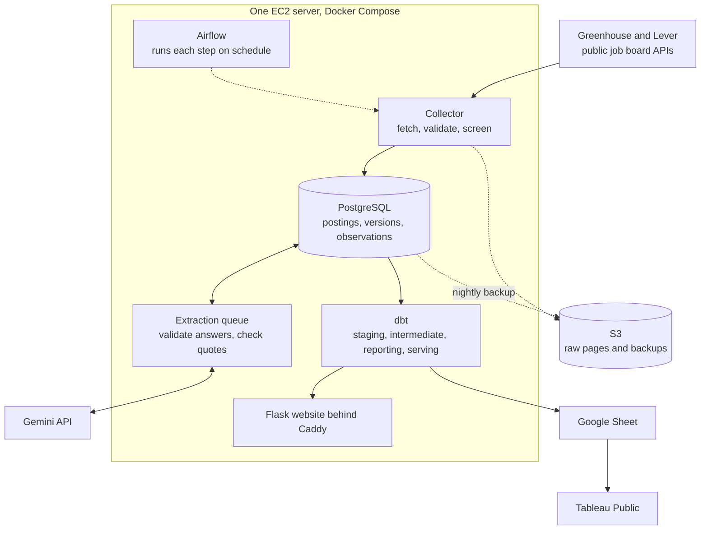

# Architecture and data model

How the pieces fit together, how a job's history is stored, and which parts of the site are
live and which are published snapshots. Back to the [README](../README.md).

## The pipeline

| Part | Role | Code |
|---|---|---|
| Greenhouse and Lever connectors | Request one board through the provider's public job board API, page through it, and turn the saved pages into validated records. Each connector decides whether a read was complete, partial, or failed. | [`connectors.py`](../src/jobmarket/connectors.py), [`greenhouse.py`](../src/jobmarket/greenhouse.py), [`lever.py`](../src/jobmarket/lever.py) |
| Collection and screening | Saves every page, stores postings, versions, and observations, and screens each job with rules (role family, DFW, Houston, or remote open to Texas). Rules, not the AI, decide which jobs are kept. | [`collector.py`](../src/jobmarket/collector.py), [`store.py`](../src/jobmarket/store.py), [`classify.py`](../src/jobmarket/classify.py) |
| Availability and duplicates | Decides when a job is possibly unavailable, assumed inactive, or closed, and groups the same opening posted twice. Both run after each collection. | [`availability.py`](../src/jobmarket/availability.py), [`duplicates.py`](../src/jobmarket/duplicates.py) |
| PostgreSQL | Holds the ingestion tables (the `public` schema), the analytics schemas dbt builds, and the owner's private workspace (`private`). Three logins keep them apart. | [`migrations/`](../src/jobmarket/migrations/) |
| Requirement extraction | A queue sends new or changed listings to Gemini one at a time, within the free-tier limits. Python validates the JSON and checks every quoted piece of evidence against the posting. | [`extraction.py`](../src/jobmarket/extraction.py), [`extraction_check.py`](../src/jobmarket/extraction_check.py) |
| dbt | Turns the stored history into staging and intermediate models, reporting tables, and serving views, with data tests. A publish builds everything in shadow schemas and swaps it in only after the tests pass. | [`analytics/`](../analytics/), [`analytics.py`](../src/jobmarket/analytics.py) |
| Serving views and reporting tables | Serving views (`srv_*`) are what job search reads. Reporting tables (`rpt_*`) are what the Reports page and the dashboards read. | [`serving/`](../analytics/models/serving/), [`reporting/`](../analytics/models/reporting/) |
| Website | Server-rendered Flask pages: search, job pages, reports, market insights, and the owner's private workspace. | [`web/`](../src/jobmarket/web/) |
| Airflow | Runs collection at noon and 9 PM America/Chicago, a retry check every 15 minutes, and an extraction batch every hour, one task at a time. Every task is an ordinary `jobmarket` command. | [`jobmarket.py`](../deploy/airflow/dags/jobmarket.py) |
| Docker Compose on EC2 | One server runs PostgreSQL, the website, Caddy (HTTPS), and Airflow. Only ports 80 and 443 are open. | [`docker-compose.yml`](../deploy/docker-compose.yml), [RUNBOOK](../deploy/RUNBOOK.md) |
| S3 | Keeps raw responses and verified nightly backups for 30 days. | [`s3store.py`](../src/jobmarket/s3store.py), [`backup.py`](../src/jobmarket/backup.py) |
| Google Sheets and Tableau Public | After each successful publication the dashboard tables are copied to a Google Sheet; the Tableau Public workbook reads the Sheet. | [`sheets.py`](../src/jobmarket/sheets.py), [docs/tableau/](tableau/) |

## Identity, versions, and observations

Three tables carry a job's history, and they answer different questions.

- **Posting identity** (`source_postings`): which job is this? A posting is identified by
  its source system, its board, and the source's own job id. A title is never an
  identifier, so two "Data Analyst" jobs at different employers stay two postings.
- **Content version** (`posting_versions`): what did the listing say? A new version is
  written only when the content changes in a meaningful way (title, wording, locations,
  compensation, employment type). Whitespace, HTML markup, and typographic quote variants do
  not count as changes.
- **Observation** (`posting_observations`): when did we see it? Every complete or partial
  scan that lists the job adds one observation, pointing at the version it showed.

An illustrative example (made-up job and times, not real data):

| Scan (America/Chicago) | What the board showed | Observation | Version | AI request |
|---|---|---|---|---|
| Oct 25, 12:00 | the job appears | 1 | v1 created | yes, for v1 |
| Oct 25, 21:00 | same text | 2 | v1 reused | no |
| Oct 26, 12:00 | "3+ years" became "2+ years" | 3 | v2 created | yes, for v2 |
| Oct 26, 21:00 | job missing from a complete scan | none | | no |
| Oct 27, 12:00 | the job is back, same text as v2 | 4 | v2 reused | no |

The repeated sightings matter even when the text does not change:

- They show the job is still listed. Observation 2 is the evidence that the job was open on
  the evening of Oct 25, and the last observation is what "last seen" means on the site.
- They narrow down when a change happened. The edit to v2 happened between observations 2
  and 3, and the site can say so.
- They drive availability. The missing job on Oct 26 counts as one absence from a complete
  scan, which makes it "possibly unavailable" but does not hide it. A failed or partial scan
  would not have counted at all.

Unchanged observations never cost an AI request. Extraction results are keyed by version
(and by the model and prompt configuration), so the five scans above make two requests, one
per version. The test
[`test_unchanged_scans_send_no_new_requests_and_edits_do`](../tests/test_extraction.py)
checks this.

Raw responses are kept separately: every page a scan received is saved with its SHA-256, so
a scan can be replayed under its original collection time while its raw pages are still on
the server (4 days; S3 keeps copies for 30 days, but replay does not read from S3). The
posting history in the three tables above is permanent. See
[Posting history](COLLECTION.md#posting-history).

## Live views and published snapshots

Two kinds of data reach the website, and they refresh differently.

| | Live (serving views) | Published snapshot (reporting tables) |
|---|---|---|
| Used by | Job search and job pages | The Reports page, the Market insights numbers, the Google Sheet, and Tableau |
| Built as | dbt views (`analytics_serving`) over the ingestion tables | dbt tables (`analytics_reporting`) |
| Refreshes | at once: a new collection or extraction is visible on the next page load | when `jobmarket analytics publish` runs, after each scheduled collection |
| Timestamp shown | "Last complete collection" per board | "Reports built ..." from `rpt_build_info`, with the collection and extraction they include |

A publication builds every model into shadow schemas, runs the data tests there, collects
planner statistics, and swaps the schemas in one transaction. If anything fails, the site
keeps the previous reports and says the latest rebuild failed. The Google Sheet is updated
only after a successful publication, and Tableau Public re-reads it about once a day, so the
dashboards can lag the Reports page by up to a day. Every dashboard carries the "data
collected through ..." caption from the publication it came from.

More detail: [Analytics](ANALYTICS.md), [Collection](COLLECTION.md),
[Extraction](EXTRACTION.md), [Website](WEBSITE.md), [Operations](OPERATIONS.md).
